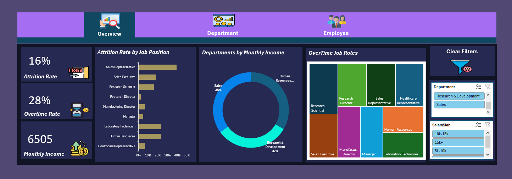
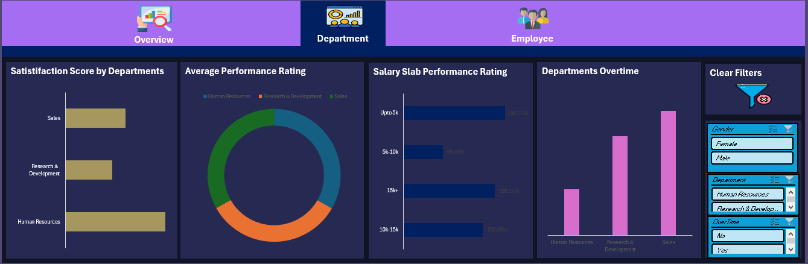
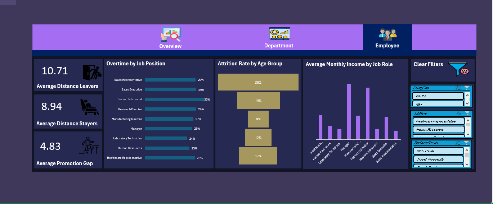

# HR Analytics Dashboard — Employee Attrition (Excel)

An interactive, three-page Excel dashboard that answers one question: **who leaves the company, and why?** It analyzes 1,480 employee records across 38 attributes and lets HR explore attrition by role, department, pay, overtime, age, and commute using slicers.

Built with **Power Query, the Excel Data Model, 21 PivotTables, 6 slicers, and VBA** for one-click filter resets.

## Business Questions

- What is the overall attrition rate, and how does it change by job role and department?
- Does overtime or low pay push employees to leave?
- Who is most at risk (age group, job role, commute distance)?
- Where should HR focus retention efforts first?

## Dashboard Pages

The workbook has three linked pages with navigation buttons (Overview, Employee, Department) and a **Clear Filters** button on each page.

### 1. Overview

KPI cards for attrition rate, overtime rate, and average monthly income, plus:

- Attrition rate by job position (bar chart)
- Departments by monthly income (donut chart)
- Overtime rate by job role (treemap)
- Slicers: Department, Salary Slab

### 2. Department

- Satisfaction score by department
- Average performance rating
- Overtime rate by department
- Performance rating by salary slab
- Slicers: Gender, Department, OverTime

### 3. Employee

- Overtime rate by job position
- Attrition rate by age group (funnel chart)
- Average monthly income by job role
- KPI cards: average distance from home for leavers and stayers, and average years before the last promotion (`YearsAtCompany − YearsSinceLastPromotion`)
- Slicers: Business Travel, Job Role, Salary Slab

## Key Insights

| Finding | Result |
|---|---|
| Overall attrition rate | **16%** |
| Employees working overtime | 28% of records |
| Attrition with overtime vs. without | **30.6% vs. 10.4%** |
| Attrition by salary slab | **21.6%** (up to 5K) vs. **3.8%** (15K+) |
| Highest-attrition job role | **Sales Representative, 39.3%** (lowest: Research Director, 2.5%) |
| Attrition by age group | **35.8%** (18–25) vs. 9.1% (36–45) |
| Commute | Leavers live farther from home: **10.7 vs. 8.9** on average |
| Highest overtime role | Research Scientist, 33.1% |
| Satisfaction score | Lowest in HR (2.60), highest in Sales (2.75) |
| Performance rating | Almost identical across departments and salary slabs (about 3.15) |
| Average monthly income | Manager 17,182 vs. Sales Representative 2,630 |

## Recommendations

1. **Review overtime workload.** Overtime is associated with roughly 3x higher attrition.
2. **Review pay for the lowest salary slab**, where attrition is more than 5x the highest slab.
3. **Focus retention on Sales Representatives and employees aged 18–25**, the two highest-risk groups.
4. **Look at commute and flexibility** (remote or hybrid options) for employees who live far from the office.
5. **Check why HR has the lowest satisfaction score.**

These are patterns in the data, not proof of cause. A deeper analysis (for example, a predictive model) would be needed to confirm what drives attrition.

## Tools

| Area | Tools |
|---|---|
| Data loading and transformation | Excel Power Query |
| Modeling | Excel Data Model |
| Analysis | 21 PivotTables |
| Interactivity | 6 slicers, navigation buttons |
| Automation | VBA macros that reset slicers (Clear Filters) |
| Visuals | Bar, donut, treemap, and funnel charts, KPI cards |

## Workbook Structure

| Sheet | Purpose |
|---|---|
| `Metadata` | Data dictionary for the 38 columns |
| `Fact Data` | The employee table loaded through Power Query (includes the derived `AgeGroup` and `SalarySlab` fields) |
| `Working Sheet` | The 21 PivotTables that feed the dashboards |
| `Wireframing` | Layout plan for the dashboards |
| `Overview`, `Department`, `Employee` | The interactive dashboard pages |

## How to Use

1. Download `HR_Analytics.xlsm` and open it in **Microsoft Excel 2016 or later** (Microsoft 365 recommended). The treemap and funnel charts do not display in older versions, LibreOffice, or Google Sheets.
2. Click **Enable Content / Enable Macros** so the Clear Filters buttons work.
3. Use the navigation buttons to move between pages and the slicers to filter the charts.
4. Click **Clear Filters** to reset the slicers on a page.
5. If you replace the source data, click **Data → Refresh All**.

## Future Improvements

- Build a Power BI version of the dashboard.
- Train a simple attrition prediction model in Python.
- Add a cohort view of attrition by tenure.

## Author

**Ahmed Akram Amer** — AI/ML Engineer & Data Analyst

- GitHub: [Ahmed-7-ML](https://github.com/Ahmed-7-ML)
- LinkedIn: [ahmed-akram-kamel-amer](https://linkedin.com/in/ahmed-akram-kamel-amer)
- Portfolio: [ahmed-amer-3ai.vercel.app](https://ahmed-amer-3ai.vercel.app/)
- Email: ahmedakram3ai@gmail.com
